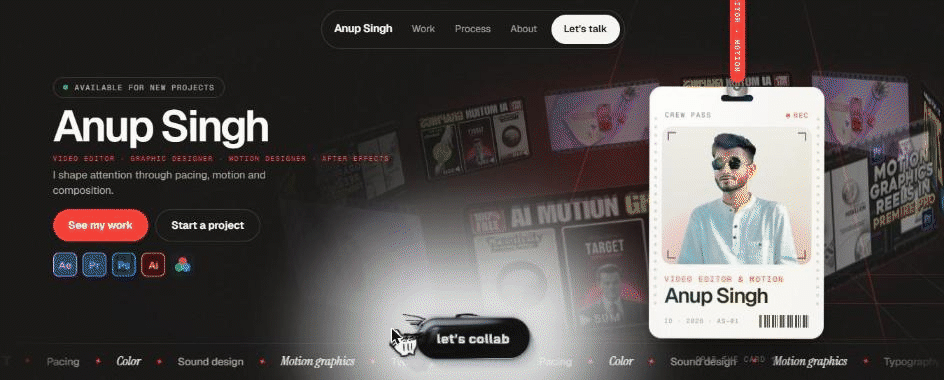
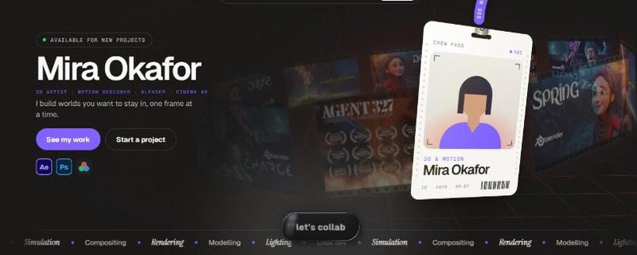
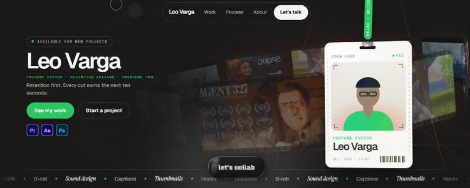
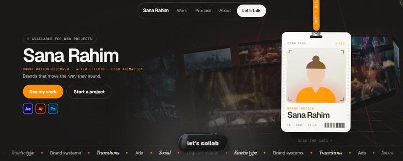

<div align="center">

# Motion Designer Portfolio Template

**A free, animated portfolio website for video editors, motion designers and 3D artists.**<br>
3D hero · draggable ID card · hover reveal photo · YouTube work rails · SEO-ready · no build step

[**Live demo**](https://brazilsingh.github.io/motion-designer-website-portfolio-demo/) ·
[**Use this template**](https://github.com/brazilsingh/motion-designer-website-portfolio-demo/generate) ·
[**AI prompts**](PROMPTS.md) ·
[**Claude skill**](skills/motion-portfolio/SKILL.md)

[](https://github.com/brazilsingh/motion-designer-website-portfolio-demo/stargazers)
[](LICENSE)
[](#make-it-yours-by-hand)

[](https://brazilsingh.github.io/motion-designer-website-portfolio-demo/)

⭐ **If this saves you a weekend, star the repo** so other editors can find it.

</div>

## One template, many styles

Each demo is the same template with different content and one accent colour. Click a demo to open it live.

| [3D artist](https://brazilsingh.github.io/motion-designer-website-portfolio-demo/?demo=3d-artist) | [YouTube editor](https://brazilsingh.github.io/motion-designer-website-portfolio-demo/?demo=yt-editor) | [Brand motion designer](https://brazilsingh.github.io/motion-designer-website-portfolio-demo/?demo=brand-motion) |
| --- | --- | --- |
| [](https://brazilsingh.github.io/motion-designer-website-portfolio-demo/?demo=3d-artist) | [](https://brazilsingh.github.io/motion-designer-website-portfolio-demo/?demo=yt-editor) | [](https://brazilsingh.github.io/motion-designer-website-portfolio-demo/?demo=brand-motion) |

The demo people are fictional. Their sample videos are [Blender Studio open movies](https://studio.blender.org/films/) (CC BY), used only to fill the layout.

## Features

- **3D hero:** a rotating ring of film frames on a perspective floor, built from your own video thumbnails.
- **Draggable ID card:** a lanyard ID card that swings when you drag it.
- **Work rails:** long-form (16:9) and Shorts (9:16) rows. Paste a YouTube link and the thumbnail loads itself.
- **Process timeline:** an editing timeline with a moving playhead.
- **Hover reveal:** move over the photo to reveal an alternate version (tap and drag on phones).
- **Contact:** copy-email button and a WhatsApp link.
- **Ready for search:** title and description, Open Graph and X cards, JSON-LD structured data, a sitemap, and real text in the HTML.
- **Light:** plain HTML, CSS and JavaScript. A lighter layout on phones, and it respects reduced-motion settings.

## Make it yours with AI

The repo includes [`AGENTS.md`](AGENTS.md), which tells the AI to ask for your details first, keep the design exactly as it is, and change only the content.

**Claude Code:** clone the repo, open it, and type:

```
/clone
```

**Any other AI** (Cursor, GitHub Copilot, Codex and others): paste this prompt:

```
Clone https://github.com/brazilsingh/motion-designer-website-portfolio-demo
and follow the "Clone flow" in its AGENTS.md to make it my portfolio.
Ask me for my details first. Keep the design; change only the content.
```

**Claude skill:** install [`skills/motion-portfolio`](skills/motion-portfolio/SKILL.md) once, then just say *"make my portfolio"* in any folder.

**More prompts:** [`PROMPTS.md`](PROMPTS.md) has ready prompts to fill it from your CV, add videos, change the colour, write your bio and translate it.

## Make it yours by hand

1. Click [**Use this template**](https://github.com/brazilsingh/motion-designer-website-portfolio-demo/generate) to get your own copy.
2. Edit the `CONTENT` object at the top of `script.js`. All visible content lives there.
3. Update the block between `<!-- SEO:START` and `<!-- SEO:END -->` in `index.html`, and the text inside the `data-c="…"` elements, so they match.
4. Replace `assets/me-front.webp` (normal photo) and `assets/me-mask.webp` (reveal photo, same size and framing).
5. Delete `demos.js`, its `<script>` tag in `index.html`, and `assets/demos/`.
6. Turn on **Settings → Pages → Deploy from branch → main / root**. Your site is live at `https://<username>.github.io/<repo>/`, free.

## Showcase

Built your portfolio with this? [**Add it here**](https://github.com/brazilsingh/motion-designer-website-portfolio-demo/issues/new?template=showcase.yml) and it'll be listed below.

*Be the first.*

## Licence and credits

- Code: MIT. See [`LICENSE`](LICENSE). The main site's photos, name, bio, video links and contact details are personal and not licensed for reuse, so replace them with your own.
- Effects adapted from [portfolio-effects](https://github.com/zzfahh/portfolio-effects) by Jaman Mahi (MIT).
- 3D "let's collab" button: [Venom Button](https://github.com/exteestudio/venom-button) by exteestudio (MIT, `collab/LICENSE`).

<div align="center">

⭐ **Star the repo** if you use it. It's the easiest way to say thanks.

</div>
